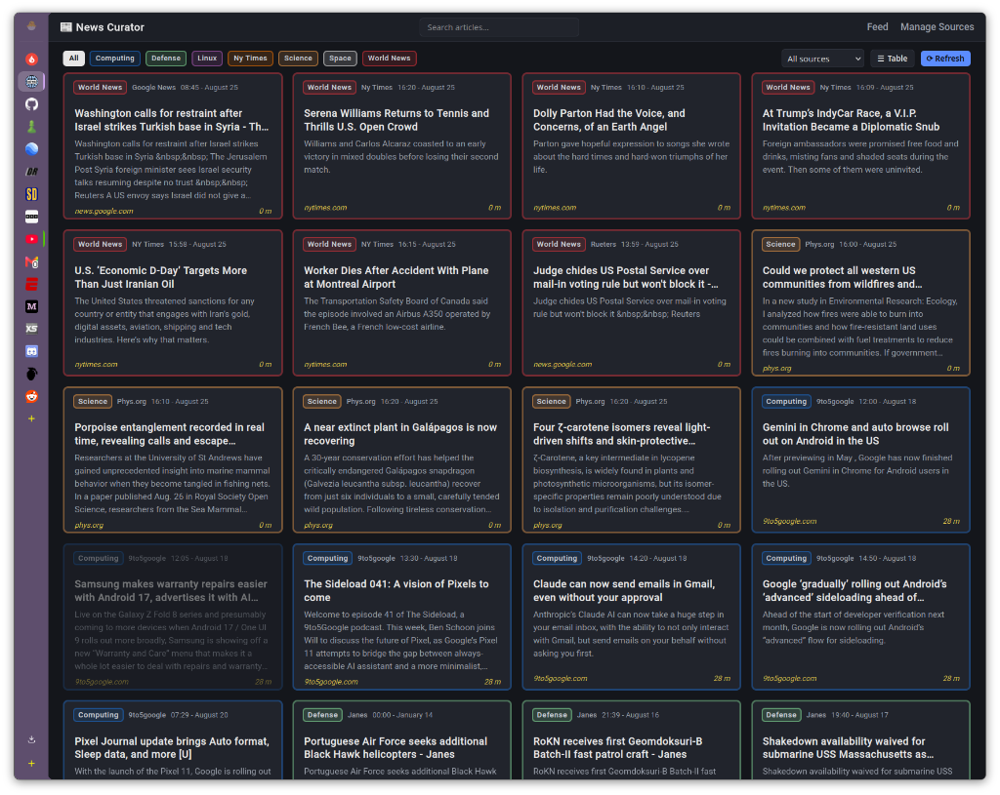
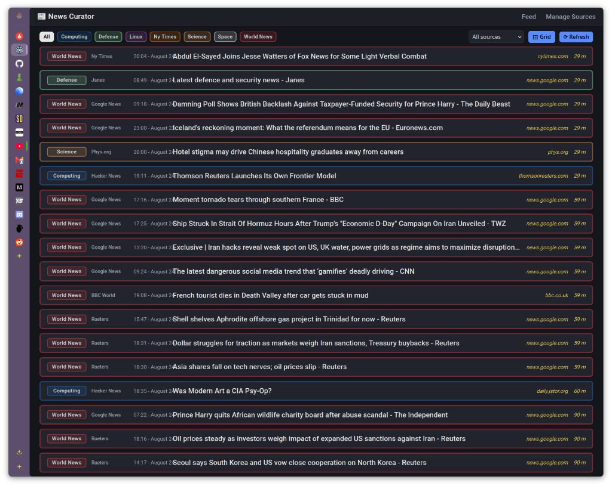
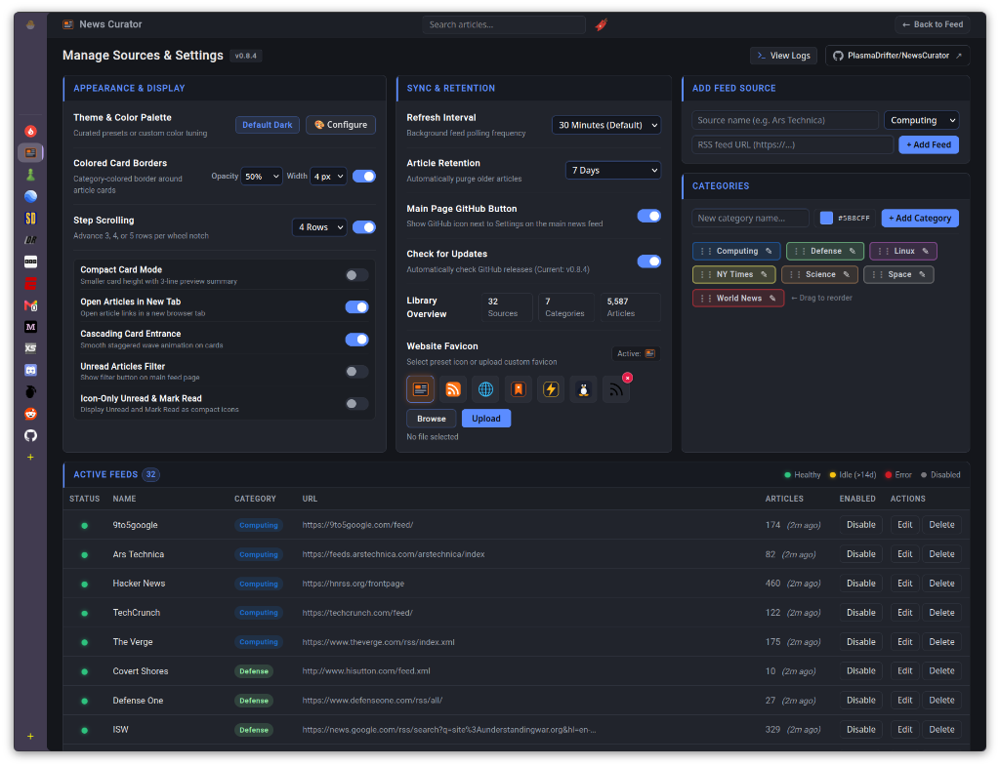

# News Curator

[](https://python.org)
[](https://fastapi.tiangolo.com)
[](https://sqlite.org)
[](https://palletsprojects.com/p/jinja/)
[](https://systemd.io)

A fast, self-hosted, dark-themed **RSS news aggregator** dashboard built with **FastAPI**, **Jinja2**, and **SQLite**, running as a native systemd user service.

This repository contains the complete web application source code, desktop integration launcher, installation scripts.

---

## Screenshots

### 1. Grid View (Card Dashboard)
Multi-column responsive card view with color-coded category borders, publication dates, source tags, and relative arrival times:


### 2. Table View (Compact List)
Compact horizontal row list layout for quickly scanning through dozens of news articles:


### 3. Manage Sources & Customization Panel
Source management dashboard for adding RSS feeds, toggling feeds on/off, creating custom categories, modifying palette colors, tuning card border size and opacity, selecting or uploading custom website favicons, and configuring article retention:


---

## Features

- **Dual Viewing Modes (Grid & Table)**
- **Compact Card Mode (3-Line Summary)**
- **Full Theme Customizer with In-App Bidirectional Shade Color Picker**
- **Unread Articles Filter & One-Click Mark All Read**
- **Feed Health & Sync Monitoring (Healthy, Idle, Error, Disabled)**
- **Balanced 3-Column Settings Dashboard**
- **Dynamic Category Styling & Custom Borders**
- **Feed Aggregation & Background Polling**
- **Comprehensive Feed & Category Management**
- **Full-Card Direct Navigation & Read Tracking**
- **Article Bookmarking & Dedicated Saved View**
- **Reading History Timeline & Recently Viewed View**
- **Integrated Top Bar Search**
- **Dynamic Infinite Scrolling**
- **Configurable Step Scrolling (3, 4, or 5 Rows)**
- **Configurable Refresh Interval (15, 30, 60 Min or Custom)**
- **Configurable Data Retention (7, 14, 30 Days)**
- **Customizable Website Favicon**
- **Category Drag-and-Drop Reordering & Modal Editor**
- **Private & Lightweight**
- **Systemd User Service Integration**

---

## Repository Structure

```text
NewsCurator/
├── README.md                      # Documentation & overview
├── install.sh                     # Automated installer (venv, dependencies, systemd & desktop setup)
├── uninstall.sh                   # Uninstaller (stops & removes systemd service, desktop launcher)
├── .gitignore                     # Git ignore rules for python cache, venv & artifacts
├── app/                           # FastAPI Application Source Code
│   ├── requirements.txt           # Python dependencies
│   ├── app/
│   │   └── main.py                # FastAPI backend routes, background feed parser, DB models, API
│   ├── data/                      # Persistent SQLite database directory
│   │   └── news.db                # SQLite database snapshot (feeds, articles, categories, settings)
│   ├── static/
│   │   ├── favicons/              # Preset website favicon SVG assets
│   │   └── style.css              # Custom dark-theme styling, grid & table CSS, animations
│   └── templates/
│       ├── base.html              # Base Jinja2 layout, centered search box, and navigation bar
│       ├── feeds.html             # Manage Sources, Retention & Settings configuration UI
│       └── index.html             # News feed dashboard with dynamic infinite scroll
├── newscurator-data/              # Database backup reference
│   └── news.db                    # SQLite database snapshot
└── screenshots/                   # Application screenshots
    ├── grid-view.png              # News dashboard in Card Grid view
    ├── table-view.png             # News dashboard in Table view
    └── manage-sources.png         # Source & category management panel
```

---

## Tech Stack & Requirements

- **Backend**: Python 3.12+ (or 3.14+), FastAPI, Uvicorn, Feedparser, Jinja2
- **Database**: SQLite 3 (WAL mode)
- **Frontend**: Vanilla JavaScript (`IntersectionObserver`), Modern CSS3 with CSS variables (Dark Catppuccin-inspired theme)
- **Service Management**: systemd user service (`newscurator.service`)

---

## Quickstart & Deployment

### 1. Automated Installation (Recommended)

Clone the repository and run the installer script:

```bash
git clone https://github.com/PlasmaDrifter/NewsCurator.git
cd NewsCurator
./install.sh
```

The installer automatically:
- Creates a dedicated Python virtual environment (`app/.venv`).
- Installs all dependencies from `requirements.txt`.
- Configures and enables a user systemd service (`~/.config/systemd/user/newscurator.service`).
- Installs the application icon and desktop launcher menu entry.
- Reloads `systemd --user` and starts `newscurator.service`.

The web dashboard will be available at: **`http://localhost:5006`**

To uninstall:
```bash
./uninstall.sh
```

---

### 2. Manual Installation & Running Directly

If you prefer installing and managing the application manually:

```bash
# Clone the repository
git clone https://github.com/PlasmaDrifter/NewsCurator.git
cd NewsCurator/app

# Create virtual environment and install dependencies
python3 -m venv .venv
source .venv/bin/activate
pip install -r requirements.txt

# Run the application
uvicorn app.main:app --host 0.0.0.0 --port 5006
```

---

### 3. Managing the Systemd Service

When installed with `./install.sh`, the service runs as a systemd user unit:

```bash
# Check service status
systemctl --user status newscurator.service

# View live application logs
journalctl --user -u newscurator.service -f

# Restart the service
systemctl --user restart newscurator.service

# Stop the service
systemctl --user stop newscurator.service
```

---

## Database Schema

The application uses SQLite with four core tables:

- **`feeds`**: Registered RSS feed URLs, feed names, category associations, enabled state, and `last_fetched` ISO timestamps.
- **`articles`**: Ingested articles (`guid`, `title`, `link`, `summary`, `image_url`, `published`, `fetched_at`, `status`, `is_bookmarked`).
- **`categories`**: Category names and their custom HEX color codes.
- **`settings`**: User configuration key-value pairs (`colored_borders`, `border_opacity`, `border_size`, `step_scroll_rows`, `card_compact`, `retention_days`, `refresh_interval`, `open_in_new_tab`, etc.).

---

## License

This project is licensed under the MIT License - see the [LICENSE](LICENSE) file for details.

---

## Community & Discussions

Got questions, setup ideas, or feedback?

* Join our subreddit at [**r/PlasmaDrifterProjects**](https://reddit.com/r/PlasmaDrifterProjects) to discuss updates, get support, and share configurations.
* Contact directly via email at [**plasmadrifter121@gmail.com**](mailto:plasmadrifter121@gmail.com).

